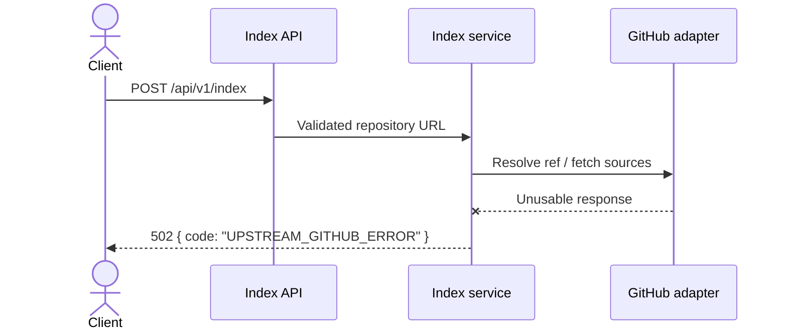
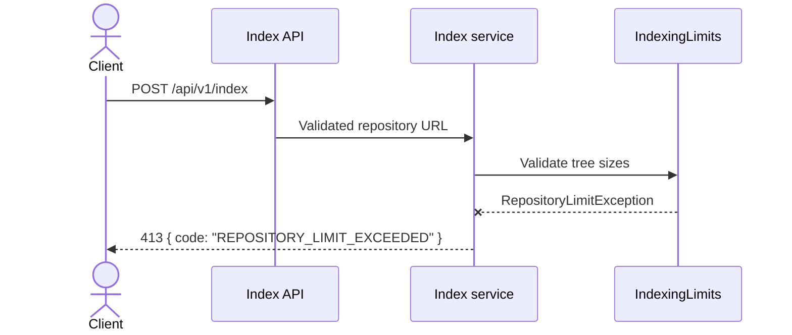
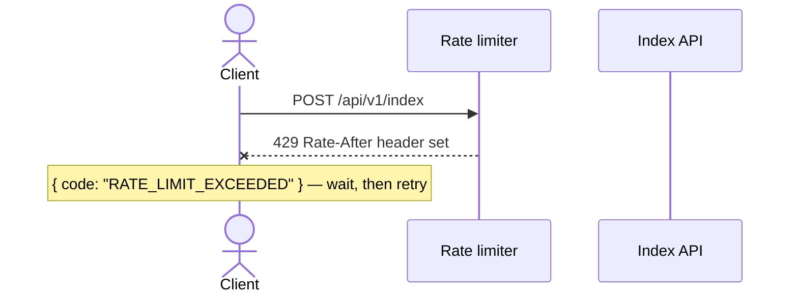

# Error code catalog

Every error response uses the stable `{ "code": "...", "message": "..." }` body.
Bodies are contract: fields are never removed or renamed. New codes may appear —
treat an unknown code per its HTTP status (4xx = fix the request or back off,
5xx = retry later). Source of truth: `ApiExceptionHandler`.

| Code | HTTP | Cause | Client action |
|---|---|---|---|
| `INVALID_REQUEST` | 400 | Invalid JSON, blank URL, a URL that is not a public `https://github.com/owner/repo` form, or a validation failure | Fix the request body; do not retry unchanged |
| `NOT_FOUND` | 404 | Unknown local route, or (via `GET /api/v1/repositories/{owner}/{repo}`) a repository that was never indexed | Check the path; index the repository first |
| `UPSTREAM_GITHUB_ERROR` | 404 | The GitHub repository or resource does not exist | Fix the URL; do not retry |
| `UPSTREAM_GITHUB_ERROR` | 403 | GitHub denied access (blocked, taken down, or forbidden resource) | Do not retry without changes; if you own the repo, check its visibility |
| `UPSTREAM_GITHUB_ERROR` | 429 | **GitHub** rate-limited *Cartograph* | Set a server-side `GITHUB_TOKEN` to raise limits, then retry with backoff |
| `UPSTREAM_GITHUB_ERROR` | 502 | GitHub returned an unusable or unexpected response | Retry with backoff; report if persistent |
| `REPOSITORY_LIMIT_EXCEEDED` | 413 | Repository exceeds the configured caps (`max-files`, `max-total-bytes`, `max-file-bytes`, `max-response-bytes`) | Use a smaller repository or raise the caps deliberately |
| `RATE_LIMIT_EXCEEDED` | 429 | **You** exceeded Cartograph's per-client indexing rate limit (`Retry-After` header is set) | Wait the indicated seconds, then retry |
| `CLONE_FAILED` | 502 | The shallow clone or checkout failed | Retry with backoff; report if persistent |
| `CLONE_COMMIT_MISMATCH` | 502 | The clone did not verify the requested commit | Retry once; report if persistent |
| `CLONE_UNAVAILABLE` | 503 | The local Git executable or clone workspace is unavailable | Retry later; check server prerequisites |
| `CLONE_DISABLED` | 503 | The required clone fallback is disabled | Enable clone fallback or use a smaller repository |
| `CLONE_TIMEOUT` | 504 | The shallow clone or checkout exceeded its timeout | Retry later; check repository size or server limits |
| `IDEMPOTENCY_CONFLICT` | 409 | The same `Idempotency-Key` was reused with a different request body | Send a fresh key, or resend the original body |
| `INTERNAL_ERROR` | 500 | Unexpected server failure; the body never contains exception details | Retry later; check server logs for the `correlationId` when present |

## The two 429s

- **`UPSTREAM_GITHUB_ERROR` (429)** — GitHub throttled *Cartograph* while fetching
  on your behalf. The fix is server-side: provide `GITHUB_TOKEN`.
- **`RATE_LIMIT_EXCEEDED` (429)** — *you* sent too many indexing requests. The
  `Retry-After` header tells you how long to wait.

## Never in an error body

Stack traces, exception messages from `INTERNAL_ERROR`, GitHub tokens, or request
credentials. If you observe any of those in an error body, that itself is a bug —
please report it.

## Failure paths

### Upstream GitHub failure

### Guardrail rejection

### Client throttling

